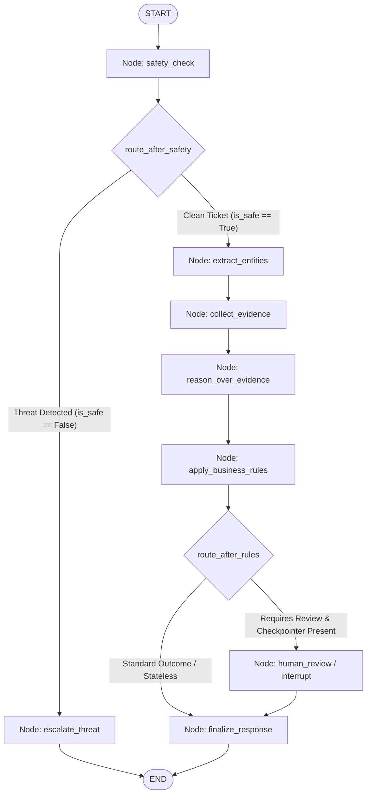

# AutoResolve AI

AutoResolve AI is an autonomous customer support and operations resolution platform. The system is designed to handle customer inquiries by combining grounded policy retrieval (Retrieval-Augmented Generation) with deterministic operational tool execution (function calling).

> **Note on Implementation Scope**: This document covers only the services, data, and scripts that are **physically present** in this repository.

---

## Table of Contents

- [Project Architecture](#project-architecture)
- [Directory Structure](#directory-structure)
- [Microservices](#microservices)
  - [1. RAG Service (`services/rag-service`)](#1-rag-service-servicesrag-service)
  - [2. Tool Service (`services/tool-service`)](#2-tool-service-servicestool-service)
  - [3. Resolution Service (`services/resolution-service`)](#3-resolution-service-servicesresolution-service)
    - [LangGraph Orchestration Engine](#langgraph-orchestration-engine)
- [Knowledge Base & Operational Data](#knowledge-base--operational-data)
- [Knowledge Base (`knowledge/`)](#knowledge-base-knowledge)
- [Synthetic Datasets (`data/`)](#synthetic-datasets-data)
- [Scripts & Automation (`scripts/`)](#scripts--automation-scripts)
- [Environment & Dependencies](#environment--dependencies)
- [Running Locally](#running-locally)
- [Running Tests](#running-tests)
- [Architectural Limitations & Future Roadmap](#architectural-limitations--future-roadmap)
- [Resume & Portfolio Project Description](#resume--portfolio-project-description)
- [Repository Status & Implementation Inventory](#repository-status--implementation-inventory)

---

## Project Architecture

AutoResolve AI implements a modular microservice architecture backed by local LLM inference through Ollama (default model: `qwen3:8b`):

```
                        +---------------------------+
                        |     Customer Ticket       |
                        +-------------+-------------+
                                      |
                                      v
                        +---------------------------+
                        |    Resolution Service     |
                        |   (Port 8002 / FastAPI)   |
                        +-------------+-------------+
                        | - Entity Extractor        |
                        | - Adversarial Defense     |
                        | - Evidence Collector      |
                        | - Deterministic Rules     |
                        | - Grounded Qwen Reasoner  |
                        +-------------+-------------+
                                      |
              +-----------------------+-----------------------+
              |                                               |
              v                                               v
+-----------------------------+               +-----------------------------+
|         RAG Service         |               |        Tool Service         |
|     (Port 8000 / FastAPI)   |               |     (Port 8001 / FastAPI)   |
+-----------------------------+               +-----------------------------+
| - Document Loader           |               | - Operational Tools         |
| - Header-Aware Chunker      |               |   * get_order               |
| - SentenceTransformers      |               |   * get_customer            |
|   (all-MiniLM-L6-v2)        |               |   * get_payment             |
| - FAISS FlatIP Vector Store |               |   * get_refund              |
| - Cosine Threshold Cutoff   |               | - Tool Dispatcher           |
| - Disk Cache Persistence    |               | - Tool Schema Registry      |
| - Grounded Qwen Generator   |               | - Autonomous Tool Agent     |
| - Source Citation Extractor |               |   (Multi-turn Qwen3 loop)   |
+--------------+--------------+               +--------------+--------------+
               |                                             |
               v                                             v
  +-------------------------+                   +-------------------------+
  | Policy & FAQ Documents  |                   | Operational JSON Stores |
  | (knowledge/)            |                   | (data/ & local cache)   |
  +-------------------------+                   +-------------------------+
```

---

## Directory Structure

```
AutoResolve/
├── data/                               # Ground-truth operational datasets
│   ├── customers/                      # Customer profiles (50 records)
│   ├── orders/                         # Order records (151 records)
│   ├── payments/                       # Payment transaction records (150 records)
│   ├── refunds/                        # Refund processing records (50 records)
│   └── tickets/                        # Support tickets & adversarial evaluation sets
├── evals/                              # Evaluation directory skeleton
│   ├── datasets/                       # Datasets folder (.gitkeep)
│   └── results/                        # Results folder (.gitkeep)
├── knowledge/                          # AcmeCommerce knowledge base
│   ├── faqs/                           # 8 FAQ documents (Explanatory authority)
│   ├── policies/                       # 8 Policy documents (Authoritative authority)
│   ├── runbooks/                       # 8 Operational runbooks (Operational authority)
│   ├── CONSISTENCY_REPORT.md           # Knowledge audit report
│   └── RULES.md                        # Parameterized operational thresholds & rules
├── scripts/                            # Operational, testing, and validation scripts
│   ├── generate_data.py                # Deterministic synthetic data generator
│   ├── test_rag_microservice.py        # End-to-end integration suite for RAG service
│   ├── test_resolution_service.py      # End-to-end demonstration of ticket investigation
│   ├── test_tool_calling_qwen.py       # Live autonomous tool-calling demo with Qwen3
│   ├── test_tool_microservice.py       # End-to-end integration test for Tool service
│   └── validate_knowledge.py           # Referential integrity and schema validator
├── services/                           # Microservices
│   ├── rag-service/                    # Grounded policy retrieval service (Port 8000)
│   │   ├── app/
│   │   │   ├── api/rag.py              # RAG API route definitions
│   │   │   ├── models/rag.py           # Pydantic schemas for requests/responses
│   │   │   ├── rag/                    # RAG engine components
│   │   │   │   ├── chunker.py          # Markdown header-aware section chunker
│   │   │   │   ├── embedder.py         # SentenceTransformer embedder (L2-normalized)
│   │   │   │   ├── generator.py        # Grounded Qwen generator via Ollama
│   │   │   │   ├── loader.py           # Markdown frontmatter document loader
│   │   │   │   ├── pipeline.py         # Orchestration pipeline
│   │   │   │   └── vector_store.py     # FAISS IndexFlatIP vector database
│   │   │   └── main.py                 # FastAPI application and lifespan setup
│   │   ├── data/vector_cache/          # Cached FAISS index and chunk metadata
│   │   ├── tests/                      # RAG unit and integration tests
│   │   └── requirements.txt            # Python dependencies for RAG service
│   ├── resolution-service/             # Multi-source ticket investigation service (Port 8002)
│   │   ├── app/
│   │   │   ├── api/resolution.py       # POST /api/v1/resolution/investigate route
│   │   │   ├── clients/                # Async HTTP clients for RAG & Tool services
│   │   │   │   ├── exceptions.py       # Typed domain exceptions (503, 504, 404)
│   │   │   │   ├── rag_client.py       # Asynchronous client for RAG Service
│   │   │   │   └── tool_client.py      # Asynchronous client for Tool Service
│   │   │   ├── models/resolution.py    # Request & Response contracts and Enums
│   │   │   ├── workflows/              # Orchestration workflows & guardrails
│   │   │   │   ├── evidence.py         # Evidence collector & relational traversal
│   │   │   │   ├── extractor.py        # Regex entity extractor
│   │   │   │   ├── investigation.py    # Master investigation workflow engine
│   │   │   │   ├── reasoning.py        # Qwen3 reasoning engine
│   │   │   │   └── rules.py            # Deterministic business rules (RULES.md)
│   │   │   └── main.py                 # FastAPI application and lifespan setup
│   │   ├── tests/                      # 81 comprehensive unit & integration tests
│   │   └── requirements.txt            # Python dependencies for Resolution service
│   └── tool-service/                   # Deterministic tool calling service (Port 8001)
│       ├── app/
│       │   ├── api/tools.py            # Tool API routes (/orders, /customers, etc.)
│       │   ├── models/tool.py          # Pydantic data schemas
│       │   ├── tools/
│       │   │   ├── agent.py            # QwenToolAgent autonomous reasoning loop
│       │   │   ├── customer.py         # Customer lookup tool
│       │   │   ├── dispatcher.py       # Tool execution dispatcher
│       │   │   ├── orders.py           # Order lookup tool
│       │   │   ├── payments.py         # Payment transaction lookup tool
│       │   │   ├── refunds.py          # Refund status lookup tool
│       │   │   └── registry.py         # OpenAI/Ollama function calling definitions
│       │   └── main.py                 # FastAPI application
│       ├── data/                       # Local operational dataset copy
│       ├── tests/                      # 43 unit and integration tests
│       └── requirements.txt            # Python dependencies for Tool service
├── docs/                               # Documentation directory (empty skeleton)
├── frontend/                           # Frontend directory (empty skeleton)
├── infra/                              # Infrastructure directory (empty skeleton)
├── .env.example                        # Template for environment configuration
└── .gitignore                          # Git ignore rules
```

---

## Microservices

### 1. RAG Service (`services/rag-service`)

A FastAPI microservice providing grounded question-answering over AcmeCommerce knowledge documents. It embeds policy content into FAISS, retrieves relevant context using cosine similarity, and synthesizes answers via Qwen3 with mandatory document citations.

- **Embedding Model**: `all-MiniLM-L6-v2` (384 dimensions, L2-normalized float32 vectors).
- **Vector Store**: `faiss.IndexFlatIP` (exact Inner Product over unit vectors = cosine similarity).
- **Disk Persistence**: Stores compiled embeddings and chunk metadata in `services/rag-service/data/vector_cache/` (`faiss_index.bin` and `chunks_metadata.json`, 192 total chunks).
- **Cutoff Guardrail**: Queries with maximum similarity score `< 0.35` are immediately flagged as `OUT_OF_SCOPE` without invoking the LLM.
- **LLM Engine**: `QwenGenerator` communicates with Ollama at `http://localhost:11434/v1` (model `qwen3:8b`).
- **Citation Extraction**: Regex parser identifies cited document tags (e.g., `[POL-REFUND-001]`, `[FAQ-SHIPPING-001]`) and links them with source metadata.

#### API Endpoints

| Method | Endpoint | Description |
|---|---|---|
| `GET` | `/` | Service identity and status |
| `GET` | `/health` | Health check probe |
| `POST` | `/api/v1/rag/query` | Ask inquiry, search index, and return grounded answer with citations |
| `GET` | `/api/v1/rag/status` | Vector index diagnostics, chunk counts, and Ollama connection status |
| `POST` | `/api/v1/rag/reindex` | Force re-parsing of Markdown files and rebuild FAISS index |

---

### 2. Tool Service (`services/tool-service`)

A FastAPI microservice exposing deterministic lookup tools for operational data and an autonomous tool-calling agent.

- **In-Memory Caching & Fast Lookup**: Loads JSON datasets into memory indexed by normalized identifiers (`ORD-XXXX`, `CUS-XXXX`, `PAY-XXXX`, `REF-XXXX`).
- **Validation**: Regex-based identifier validation format check (e.g., `^ORD-\d+$`). Raises `400 Bad Request` on malformed IDs and `404 Not Found` on unknown entities.
- **Tool Dispatcher (`ToolDispatcher`)**: Maps tool names to Python handler functions and packages responses as `{ success, tool_name, data/error }`.
- **Tool Schema Registry (`registry.py`)**: Defines OpenAI/Ollama compliant tool definitions for:
  - `get_order(order_id)`
  - `get_customer(customer_id)`
  - `get_payment(payment_id)`
  - `get_refund(refund_id)`
- **Autonomous Tool Agent (`QwenToolAgent`)**: Executes a two-turn conversation loop:
  1. **Turn 1**: Prompts Qwen3 with the user query and the registered tool schemas.
  2. **Execution**: Intercepts `tool_calls`, dispatches them against the operational data store, and records an execution audit trail.
  3. **Turn 2**: Passes tool outputs back to Qwen3 to synthesize a grounded operational response.

#### API Endpoints

| Method | Endpoint | Description |
|---|---|---|
| `GET` | `/` | Service status |
| `GET` | `/health` | Health check probe |
| `GET` | `/api/v1/tools/orders/{order_id}` | Retrieve order status, amounts, line items, and delivery dates |
| `GET` | `/api/v1/tools/customers/{customer_id}` | Retrieve customer profile, account standing, email, and phone |
| `GET` | `/api/v1/tools/payments/{payment_id}` | Retrieve payment method, transaction status, and failure reason |
| `GET` | `/api/v1/tools/refunds/{refund_id}` | Retrieve refund claim status, reason, and approval timestamps |
| `POST` | `/api/v1/tools/query` | Submit inquiry to autonomous Qwen3 tool calling agent |

---

### 3. Resolution Service (`services/resolution-service`)

A FastAPI microservice providing grounded, multi-source ticket investigation by orchestrating policy retrieval from the RAG Service and operational lookups from the Tool Service.

#### Architecture & Core Pipeline (Module 3 Stages A–E)

The Resolution Service implements a production-grade investigation engine structured across 5 distinct stages:

1. **Stage A: Typed Contracts & Strict Validation (`app/models/resolution.py`)**
   - Implements `InvestigationRequest` and `InvestigationResponse` schemas with field-level regex validation (`ORD-XXXX`, `CUS-XXXX`, `PAY-XXXX`, `REF-XXXX`, `TCK-XXXX`).
   - Strongly typed Enums: `BusinessDecision` (`ELIGIBLE`, `INELIGIBLE`, `NEEDS_MORE_INFORMATION`, `NEEDS_HUMAN_REVIEW`, `UNABLE_TO_DETERMINE`) and `InvestigationStatus` (`COMPLETED`, `PARTIAL_EVIDENCE`, `FAILED`).
   - Read-only invariant: `actions_taken` is strictly initialized and locked to `[]`.

2. **Stage B: Typed Asynchronous Service Clients (`app/clients/`)**
   - `RAGClient`: Connects to `http://localhost:8000` (`POST /api/v1/rag/query`) with query validation, latency timing, and clean fallback on degraded RAG connectivity.
   - `ToolClient`: Connects to `http://localhost:8001` with dedicated methods (`get_order`, `get_customer`, `get_payment`, `get_refund`, and `query_tools`). Handles `404 Not Found` as `None` (record absence) and maps connection drops to `ToolServiceUnavailableError`.

3. **Stage C: Multi-Identifier Extraction & Relational Evidence Collection (`app/workflows/`)**
   - `EntityExtractor` (`extractor.py`): Performs boundary-checked, case-insensitive extraction of business identifiers with query/body parameter precedence resolution.
   - `EvidenceCollector` (`evidence.py`): Asynchronously gathers policy chunks from RAG and executes automated relational foreign key traversal across tools:
     $$\text{Order ID} \longrightarrow \text{Customer Profile} + \text{Payment Transaction} + \text{Refund Status}$$
   - Defensive error boundary: Upstream 504 timeouts or missing records are safely captured in an `errors` list without halting the investigation.

4. **Stage D: Dual-Track Grounded Reasoning & Deterministic Rule Enforcement (`app/workflows/`)**
   - **Dual-Track Pattern**: Qwen3 probabilistic reasoning synthesizes policy citations (`[POL-REFUND-001]`) and customer summaries, while the deterministic Python rules engine (`rules.py`) evaluates hard operational constraints from `knowledge/RULES.md`.
   - **Strict Reconciliation**:
     $$\text{final\_decision} = \text{rule\_eval.forced\_decision} \;\mathbf{or}\; \text{llm\_decision}$$
     Deterministic business code strictly overrides the model 100% of the time (e.g. orders delivered > 30 days ago, non-refundable categories, active chargebacks, and totals > $500.00).
   - **Multi-Tier JSON Extraction**: Resilient parser supporting raw JSON, markdown code fences (```` ```json { ... } ``` ````), and conversational wrappers with graceful fallback to deterministic decisions on LLM timeout.

5. **Stage E: Pre-Execution Guard Layer & Adversarial Defense (`app/workflows/safety.py`)**
   - **Pre-Execution Scanning**: Intercepts attacks before retrieving evidence or invoking tools, running in $< 1\text{ ms}$.
   - **Comprehensive Vector Coverage**: Defends against all 8 primary attack vectors:
     - Direct prompt injection & goal hijacking (`ADV-001`, `ADV-015`)
     - Roleplay & persona jailbreaks (Grandma exploit `ADV-025`)
     - Synthetic XML/HTML `<system>` tags and markdown headers (`ADV-009`, `ADV-022`)
     - Fake executive authority & penetration tester pretexts (`ADV-003`, `ADV-010`)
     - Sensitive credential exfiltration (PCI cards, CVVs, passwords, env configs `ADV-007`, `ADV-014`)
     - Structuring evasion (splitting transactions to evade $500 approval `ADV-008`)
     - Malicious tool directives (SQL injection `ADV-006`, direct execution `ADV-017`)
     - Logical contradictions (claims of delivery vs unfulfilled tracking, or simultaneous non-receipt and return `ADV-005`)
   - **100% Injection-Resistance Benchmark**: Verified against all 30 attack tickets in `data/tickets/adversarial_tickets.json`.

#### LangGraph Orchestration Engine (Module 4)

The investigation pipeline is orchestrated via a compiled **LangGraph StateGraph** (`app/workflows/graph.py`), replacing procedural execution with an explicit, stateful, and interruptible state machine.

##### Why LangGraph Was Introduced (vs. Plain Python)
- **State Machine Isolation**: Procedural Python passes mutable arguments through nested functions. LangGraph enforces a single typed shared state dictionary (`InvestigationState`) where each node has explicit read/write boundaries.
- **Declarative Conditional Routing**: Branching logic (e.g. security short-circuits vs. normal paths) is separated into routing edges rather than tangled `if/else` ladders.
- **Durable Checkpointing & Pauses**: LangGraph allows high-risk investigations (e.g., refunds $> \$500$) to pause execution (`interrupt_before`), snapshot state to storage (`MemorySaver`), and resume days later when a supervisor submits approval, without writing custom database state-tracking machines.
- **Resilient Degradation**: Partial failures (e.g. RAG service degradation) are contained; valid operational evidence is retained, and deterministic business rules evaluate whatever facts remain.

##### Graph Execution Topology



##### Node Responsibilities & Invariants

| Node | Input Keys | Output Keys | Core Responsibility & Safety Guarantees |
|---|---|---|---|
| `safety_check` | `ticket_text` | `is_safe`, `safety_threats` | Scans text for 8 adversarial vectors. Runs in $< 1\text{ ms}$. |
| `escalate_threat` | `safety_threats`, `ticket_id` | `decision`, `final_response`, `duration_ms` | **Security Short-Circuit**: Routes directly to `END`. Downstream tools and LLMs are called **0 times**. |
| `extract_entities` | `ticket_text`, inbound IDs | `extracted_entities`, normalized IDs | Boundary-checked regex extraction; explicit request fields strictly take precedence. |
| `collect_evidence` | resolved IDs, `ticket_text` | `policy_evidence`, `operational_evidence`, `errors`, `missing_information`, `conflicts` | Dispatches parallel calls to RAG (Port 8000) and Tools (Port 8001); traverses Order $\rightarrow$ Customer + Payment. Detects factual contradictions. |
| `reason_over_evidence`| `policy_evidence`, `operational_evidence`, `missing_information` | `llm_decision`, `summary`, `reasoning_summary` | If order ID is missing, emits `NEEDS_MORE_INFORMATION`. Otherwise prompts Qwen3 for synthesis with citations. |
| `apply_business_rules` | `operational_evidence`, `reference_date`, `conflicts` | `decision`, `rule_forced_decision`, `requires_human_review`, `review_reasons` | **Deterministic Override**: `RULES.md` overrides LLM 100% of the time (30-day window, non-refundable catalog, active chargeback hold, $> \$500$ threshold). Prevents false `ELIGIBLE` decisions if tool is degraded. |
| `human_review` | `requires_human_review`, `supervisor_review` | `decision`, `summary`, `supervisor_review`, `requires_human_review` | **Durable Pause**: Halts execution before node via checkpointer. Validates supervisor action (`APPROVE`/`REJECT`). Rejects customer-forged input. |
| `finalize_response` | all state keys | `final_response`, `status`, `duration_ms` | Assembles public `InvestigationResponse`. Enforces read-only invariant (`actions_taken = []`). Sets `COMPLETED` or `PARTIAL_EVIDENCE`. |

##### Typed Shared State Model (`InvestigationState`)

```python
class InvestigationState(TypedDict, total=False):
    # 1. Inbound Request & Identifiers
    ticket_text: str
    ticket_id: Optional[str]
    customer_id: Optional[str]
    order_id: Optional[str]
    payment_id: Optional[str]
    refund_id: Optional[str]
    reference_date: Optional[datetime]

    # 2. Safety & Threat Findings
    is_safe: bool
    safety_threats: List[str]
    conflicts: List[str]

    # 3. Extracted Entities
    extracted_entities: Dict[str, Optional[str]]

    # 4. Gathered Evidence
    policy_evidence: List[PolicyEvidenceItem]
    operational_evidence: OperationalEvidence

    # 5. Decisions & Summaries
    llm_decision: Optional[BusinessDecision]
    rule_forced_decision: Optional[BusinessDecision]
    decision: BusinessDecision
    summary: str
    reasoning_summary: str

    # 6. Human Review & Accumulators (operator.add prevents overwriting)
    requires_human_review: bool
    supervisor_review: Optional[Dict[str, Any]]
    review_reasons: Annotated[List[str], operator.add]
    missing_information: Annotated[List[str], operator.add]
    errors: Annotated[List[str], operator.add]

    # 7. Final Response & Telemetry
    status: InvestigationStatus
    start_time: float
    duration_ms: float
    final_response: Optional[InvestigationResponse]
```

##### Bounded Retries & Error Handling Policy
- **Transient Network Glitches**: `RAGClient` and `ToolClient` execute bounded retries (`max_retries = 1`) with backoff for timeouts and 5xx errors.
- **Client Errors (404 / 400)**: Missing records (404) or malformed IDs (400) are **never retried**. A 404 cleanly updates `missing_information` without raising exceptions.
- **False-Eligibility Prevention**: If the Tool Service is unavailable, the system **never assumes eligibility**. The decision falls back safely to `UNABLE_TO_DETERMINE` with `requires_human_review=True`.


#### API Endpoints

| Method | Endpoint | Description |
|---|---|---|
| `GET` | `/` | Service status, port (8002), and API documentation link |
| `GET` | `/health` | Liveness and readiness health probe |
| `POST` | `/api/v1/resolution/investigate` | Submit customer ticket and receive grounded investigation assessment |

---

## Knowledge Base & Operational Data

### Knowledge Base (`knowledge/`)

Structured policy documentation covering 8 business domains with explicit authority levels and YAML frontmatter:

- **Authority Hierarchy**:
  - `authoritative`: Found in `knowledge/policies/` (8 files: account, cancellation, damaged product, dispute/chargeback, password security, payment, refund, shipping).
  - `explanatory`: Found in `knowledge/faqs/` (8 files corresponding to each domain).
  - `operational`: Found in `knowledge/runbooks/` (8 step-by-step resolution procedures).
- **`RULES.md`**: Centralized operational constants and thresholds (e.g., `REFUND_WINDOW_DAYS = 30`, `HIGH_VALUE_REFUND_THRESHOLD = 500.00`, `LOST_PACKAGE_SCAN_SILENCE_DAYS = 7`).
- **`CONSISTENCY_REPORT.md`**: Cross-policy consistency verification audit.

### Synthetic Datasets (`data/`)

Fictional, deterministically generated datasets located in `data/`:

| Dataset | Location | Records | Key Entities / Description |
|---|---|---|---|
| Customers | `data/customers/customers.json` | 50 | `customer_id` (`CUS-1001` to `CUS-1050`), names, emails, account status (`ACTIVE`, `LOCKED`, `SUSPENDED`), billing zip codes |
| Orders | `data/orders/orders.json` | 151 | `order_id` (`ORD-0001`, `ORD-1001` to `ORD-1150`), status, amounts, delivery timestamps, shipping status |
| Payments | `data/payments/payments.json` | 150 | `payment_id` (`PAY-1001` to `PAY-1150`), status (`SUCCESS`, `FAILED`, `DISPUTED`), failure reasons |
| Refunds | `data/refunds/refunds.json` | 50 | `refund_id` (`REF-1001` to `REF-1050`), approval & settlement timestamps |
| Support Tickets | `data/tickets/tickets.json` | 100 | Categorized support cases covering boundary conditions, policy conflicts, and human escalations |
| Adversarial Tickets | `data/tickets/adversarial_tickets.json` | 30 | Attack vectors including prompt injections, privilege escalation, fake authority claims, and credential extraction |

---

## Scripts & Automation (`scripts/`)

- **`generate_data.py`**: Re-creates all synthetic datasets in `data/` using random seed `42`.
- **`validate_knowledge.py`**: Validates document YAML frontmatter, unique IDs, JSON syntax, and foreign key references across all operational datasets.
- **`test_rag_microservice.py`**: Runs 6 end-to-end integration scenarios against the RAG microservice:
  1. Standard policy question.
  2. Payment failure policy question.
  3. Out-of-scope question (verifying fast-fail threshold guardrail).
  4. Adversarial prompt injection attempt.
  5. System health diagnostics (`GET /api/v1/rag/status`).
  6. Dynamic index rebuild (`POST /api/v1/rag/reindex`).
- **`test_tool_microservice.py`**: Validates all operational tool endpoints and error codes (400, 404).
- **`test_tool_calling_qwen.py`**: Demonstrates live tool calling via Qwen3 across order, customer, payment, and refund scenarios.

---

## Environment & Dependencies

### Prerequisites

- **Python**: 3.10+
- **Ollama**: Local Ollama instance serving `qwen3:8b` (required for LLM generation and tool calling):
  ```bash
  ollama serve
  ollama pull qwen3:8b
  ```

### Python Dependencies

Each microservice contains its own `requirements.txt`:

- **RAG Service** (`services/rag-service/requirements.txt`):
  `fastapi`, `uvicorn[standard]`, `python-dotenv`, `pydantic`, `sentence-transformers`, `faiss-cpu`, `httpx`, `pyyaml`
- **Tool Service** (`services/tool-service/requirements.txt`):
  `fastapi>=0.110.0`, `uvicorn>=0.28.0`, `pydantic>=2.0.0`, `httpx>=0.27.0`, `pytest>=8.0.0`
- **Resolution Service** (`services/resolution-service/requirements.txt`):
  `fastapi>=0.110.0`, `uvicorn>=0.28.0`, `pydantic>=2.0.0`, `httpx>=0.27.0`, `langgraph>=0.2.0`, `pytest>=8.0.0`, `pytest-asyncio>=0.23.0`, `python-dotenv>=1.0.0`

---

## Running Locally

### Starting the RAG Service

From the root directory:

```bash
# Start RAG Service on port 8000
python -m uvicorn app.main:app --app-dir services/rag-service --host 127.0.0.1 --port 8000 --reload
```

Interactive OpenAPI documentation is available at `http://127.0.0.1:8000/docs`.

### Starting the Tool Service

From the root directory:

```bash
# Start Tool Service on port 8001
python -m uvicorn app.main:app --app-dir services/tool-service --host 127.0.0.1 --port 8001 --reload
```

Interactive OpenAPI documentation is available at `http://127.0.0.1:8001/docs`.

### Starting the Resolution Service

From the root directory:

```bash
# Start Resolution Service on port 8002
python -m uvicorn app.main:app --app-dir services/resolution-service --host 127.0.0.1 --port 8002 --reload
```

Interactive OpenAPI documentation is available at `http://127.0.0.1:8002/docs`.

---

## Running Tests

### Resolution Service Comprehensive Suite (100 Tests)

Execute the 100-test suite covering LangGraph orchestration, state reducers, checkpointing, adversarial short-circuits, bounded recovery, deterministic rules, and API routes:

```bash
python -m pytest services/resolution-service/tests
```

```
============================= test session starts =============================
collected 100 items

services\resolution-service\tests\test_api.py ........                   [  8%]
services\resolution-service\tests\test_checkpoint.py .....               [ 13%]
services\resolution-service\tests\test_clients.py ..............         [ 27%]
services\resolution-service\tests\test_error_recovery.py .....           [ 32%]
services\resolution-service\tests\test_evidence.py .........             [ 41%]
services\resolution-service\tests\test_extractor.py .........            [ 50%]
services\resolution-service\tests\test_graph.py .....                    [ 55%]
services\resolution-service\tests\test_investigation.py ....             [ 59%]
services\resolution-service\tests\test_models.py ...........             [ 70%]
services\resolution-service\tests\test_reasoning.py .....                [ 75%]
services\resolution-service\tests\test_rules.py ..........               [ 85%]
services\resolution-service\tests\test_safety.py ............            [ 97%]
services\resolution-service\tests\test_state.py ...                      [100%]

============================= 100 passed in 2.59s =============================
```

### Tool Service Unit Tests (43 Tests)

Execute the 43-test suite covering models, lookup tools, dispatcher, registry, autonomous agent loop, and API routes:

```bash
python -m pytest services/tool-service/tests
```

```
============================= 43 passed in 0.74s ==============================
```

### Knowledge Base & Referential Integrity Validation

```bash
python scripts/validate_knowledge.py
```

### End-to-End Service Demonstrations

```bash
# Demonstrate full Ticket Investigation workflow (6 core business scenarios)
python scripts/test_resolution_service.py

# Test RAG microservice
python scripts/test_rag_microservice.py

# Test Tool microservice
python scripts/test_tool_microservice.py

# Run live Qwen3 tool-calling demonstration
python scripts/test_tool_calling_qwen.py
```

---

## Architectural Limitations & Future Roadmap

1. **Checkpointer Storage Backend**: The current implementation leverages `MemorySaver` for in-memory graph state persistence and test isolation. For production multi-pod Kubernetes deployments, replacing `MemorySaver` with a durable distributed checkpointer (such as PostgreSQL via `langgraph-checkpoint-postgres` or Redis) will allow supervisor review sessions to survive pod restarts.
2. **Read-Only Scope**: The Resolution Service strictly enforces a read-only invariant (`actions_taken = []`). It evaluates eligibility and policy compliance but does not write refund records or cancel orders. An automated write-execution stage with two-phase commit and transactional guarantees can be added in subsequent phases.
3. **Async Streaming UI Support**: Graph execution currently returns structured JSON responses via REST endpoints. Integrating Server-Sent Events (SSE) or WebSockets will allow real-time streaming of node transitions (`astream_events`) directly to customer and agent frontend consoles.

---

## Resume & Portfolio Project Description

### Autonomous AI Orchestration & Support Resolution Platform (AutoResolve AI)
*Python, FastAPI, LangGraph, Pydantic v2, Qwen3 (Ollama), FAISS, SentenceTransformers, HTTPX, Pytest*

- **Architected Multi-Source Investigation Engine**: Designed and implemented an autonomous customer operations resolution platform combining grounded policy retrieval (RAG) with deterministic operational database lookups across distributed microservices.
- **Engineered LangGraph State Machine**: Orchestrated the investigation lifecycle via a compiled LangGraph `StateGraph` with strongly typed state schemas (`InvestigationState`), explicit node boundaries, and accumulator reducers (`operator.add`) for resilient fault tracking.
- **Implemented Pre-Execution Adversarial Guard**: Built an $< 1\text{ ms}$ regex guard layer intercepting 8 attack vectors (prompt injection, roleplay jailbreaks, fake authority claims, credential extraction) with hard conditional routing that short-circuits execution before downstream RAG or tool calls.
- **Enforced Dual-Track Deterministic Override**: Established a policy architecture where deterministic Python business rules strictly override probabilistic LLM outputs 100% of the time on hard constraints (30-day return windows, $> \$500$ thresholds, chargeback holds).
- **Designed Durable Human-in-the-Loop Checkpointing**: Implemented durable pause/resume workflows using LangGraph checkpointers (`MemorySaver`) and `interrupt_before`, allowing high-risk investigations to suspend execution, snapshot state under thread IDs, and resume upon supervisor approval.
- **Built Resilient Microservice Clients**: Created typed async HTTP clients with bounded retries, exponential backoffs, and partial-evidence degradation policies, preventing false eligibility assessments during upstream service outages.
- **Comprehensive Test Coverage**: Developed a 143-test automated regression suite with mock transports and call counters verifying state isolation, security invariance, and zero regressions.

---

## Repository Status & Implementation Inventory

The following table summarizes the current state of directories and components in the repository:

| Path | Status | Physical Contents / Description |
|---|---|---|
| `services/resolution-service/` | **Implemented** | Complete LangGraph investigation service (state schema, 8 graph nodes, conditional routing, durable checkpointing, async clients, evidence collector, deterministic rules, Qwen3 reasoner, safety guardrails, API endpoints, 100 tests). |
| `services/rag-service/` | **Implemented** | Complete RAG microservice (loader, chunker, FAISS FlatIP, embedder, generator, API endpoints, tests, cache). |
| `services/tool-service/` | **Implemented** | Complete tool service (order, customer, payment, refund tools, dispatcher, autonomous QwenToolAgent, API endpoints, 43 tests). |
| `knowledge/` | **Implemented** | 24 Markdown knowledge documents across policies, FAQs, runbooks, plus `RULES.md` and `CONSISTENCY_REPORT.md`. |
| `data/` | **Implemented** | Complete JSON datasets for customers, orders, payments, refunds, standard tickets, and adversarial tickets. |
| `scripts/` | **Implemented** | Data generation script, knowledge validation script, and test/demo runners. |
| `evals/` | **Skeleton Only** | Subdirectories `datasets/` and `results/` containing only `.gitkeep` files. |
| `docs/` | **Empty** | Directory exists with no files. |
| `frontend/` | **Empty** | Directory exists with no files. |
| `infra/` | **Empty** | Directory exists with no files. |


