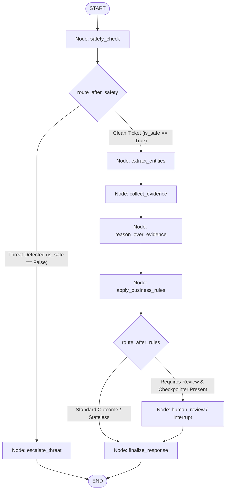

# AutoResolve AI

**Autonomous Multi-Agent Customer Support & Operations Resolution Platform**

AutoResolve AI is a production-grade autonomous customer operations platform that investigates, validates, and executes customer support workflows. It bridges grounded policy retrieval (**Retrieval-Augmented Generation** via FAISS and SentenceTransformers) with deterministic operational database execution (**SQLite & Function Calling**) orchestrated by a compiled **LangGraph StateGraph**.

The platform features a **Two-Phase Action Execution Engine** (read-only investigation followed by authoritative mutations), **Asynchronous Human-in-the-Loop (HITL) Alerting**, an **Apple iOS Liquid Glass & Laminar Flow** customer experience, an **Operations Admin Console**, and a **Single-Command Unified Microservice Orchestrator** (`app.py`).

---

## Table of Contents

- [System Architecture](#system-architecture)
- [Directory Structure](#directory-structure)
- [Core Microservices & Architecture](#core-microservices--architecture)
  - [1. LangGraph Resolution & Investigation Engine (`services/resolution-service` - Port 8002)](#1-langgraph-resolution--investigation-engine-servicesresolution-service---port-8002)
  - [2. RAG Knowledge & Policy Service (`services/rag-service` - Port 8000)](#2-rag-knowledge--policy-service-servicesrag-service---port-8000)
  - [3. Operational Tool & Database Service (`services/tool-service` - Port 8001)](#3-operational-tool--database-service-servicestool-service---port-8001)
  - [4. Next.js Web Portal & Dual UI (`frontend` - Port 3000)](#4-nextjs-web-portal--dual-ui-frontend---port-3000)
- [Key Engineering Innovations](#key-engineering-innovations)
  - [Two-Phase Action Execution Engine](#two-phase-action-execution-engine)
  - [Asynchronous HITL Alerting & Admin Review API](#asynchronous-hitl-alerting--admin-review-api)
  - [Apple iOS Liquid Glass & Laminar Flow UI](#apple-ios-liquid-glass--laminar-flow-ui)
  - [Unified Single-Command Launcher (`app.py`)](#unified-single-command-launcher-apppy)
- [Knowledge Base & Operational Data](#knowledge-base--operational-data)
- [Quickstart & Running Locally](#quickstart--running-locally)
  - [Prerequisites](#prerequisites)
  - [Single-Command Launch (`app.py`)](#single-command-launch-apppy)
  - [Manual Service Startup](#manual-service-startup)
- [API Reference](#api-reference)
- [Testing & Quality Assurance](#testing--quality-assurance)
  - [Resolution Service Suite (100 Tests)](#resolution-service-suite-100-tests)
  - [Tool Service Suite (43 Tests)](#tool-service-suite-43-tests)
  - [RAG Service Suite (4 Tests)](#rag-service-suite-4-tests)
  - [Knowledge Base Validation](#knowledge-base-validation)
  - [Frontend Production Build](#frontend-production-build)
- [Empirical Benchmarks & Stress Evaluation](#empirical-benchmarks--stress-evaluation)
  - [1. Adversarial Security Benchmark (30 Vectors)](#1-adversarial-security-benchmark-30-vectors)
  - [2. High-Concurrency Stress Benchmark (300 Requests)](#2-high-concurrency-stress-benchmark-300-requests)
  - [3. 50 Diverse Customer Inquiries Benchmark](#3-50-diverse-customer-inquiries-benchmark)
  - [4. Isolated Microservice Latency Profiling](#4-isolated-microservice-latency-profiling)
- [Resume & Portfolio Project Description](#resume--portfolio-project-description)

---

## System Architecture

AutoResolve AI coordinates multiple specialized services through strict contracts, state machine routing, and defensive boundaries:

```
                            +---------------------------------------+
                            |       Next.js Web Portal (Port 3000)  |
                            |  - Customer Care Portal (/customer)   |
                            |  - Operations Admin Console (/admin)  |
                            +-------------------+-------------------+
                                                |
                                                | HTTP REST / JSON
                                                v
                            +---------------------------------------+
                            |      Resolution LangGraph Engine      |
                            |         (Port 8002 / FastAPI)         |
                            +---------------------------------------+
                            |  [1] Pre-Execution Safety Guard (<1ms)|
                            |  [2] Entity Extractor (ORD/CUS/PAY)   |
                            |  [3] Concurrent Evidence Collector    |
                            |  [4] Qwen3 Probabilistic Reasoner     |
                            |  [5] Deterministic Business Rules     |
                            |  [6] Durable SQLite HITL Checkpointer |
                            |  [7] Asynchronous Alert Dispatcher    |
                            |  [8] Two-Phase Action Controller      |
                            +-------------------+-------------------+
                                                |
                       +------------------------+------------------------+
                       |                                                 |
                       v                                                 v
        +-----------------------------+                   +-----------------------------+
        |         RAG Service         |                   |        Tool Service         |
        |     (Port 8000 / FastAPI)   |                   |     (Port 8001 / FastAPI)   |
        +-----------------------------+                   +-----------------------------+
        | - Document Loader (YAML)    |                   | - Read Operations:          |
        | - Header-Aware Chunker      |                   |   * get_order / get_customer|
        | - SentenceTransformers      |                   |   * get_payment / get_refund|
        |   (all-MiniLM-L6-v2, 384d)  |                   | - Write Operations:         |
        | - FAISS FlatIP Vector Index |                   |   * execute_refund          |
        | - Cosine Cutoff (< 0.35)    |                   |   * update_order_status     |
        | - Grounded Qwen Generator   |                   |   * generate_return_label   |
        | - Source Citation Parser    |                   | - SQLite WAL Data Layer     |
        +--------------+--------------+                   +--------------+--------------+
                       |                                                 |
                       v                                                 v
        +-----------------------------+                   +-----------------------------+
        |   Knowledge Base (Markdown) |                   |  Shared SQLite Database     |
        |   24 Policies, FAQs, Runbooks|                  |  (data/autoresolve.db)      |
        +-----------------------------+                   +-----------------------------+
```

---

## Directory Structure

```
AutoResolve/
├── app.py                              # Unified orchestrator (Port 8000, 8001, 8002, 3000)
├── data/                               # Operational data store & SQLite databases
│   ├── autoresolve.db                  # Shared SQLite operational database (WAL mode)
│   ├── checkpoints.db                  # LangGraph SQLite durable state checkpointer
│   ├── customers/                      # Customer profile dataset (50 records)
│   ├── orders/                         # Order records dataset (150 records)
│   ├── payments/                       # Payment transaction records (150 records)
│   ├── refunds/                        # Refund processing records (50 records)
│   └── tickets/                        # Support tickets (100) & adversarial evaluation (30)
├── frontend/                           # Next.js 14 App Router portal (Port 3000)
│   ├── app/                            # Route pages: /, /customer, /admin
│   ├── components/                     # Apple iOS Liquid Glass UI components
│   │   ├── LaminarFlowBackground.tsx   # Canvas-based laminar fluid dynamic background
│   │   ├── ReturnVoucherModal.tsx      # Return authorization voucher & barcode generator
│   │   └── TrackingStepper.tsx         # UPS package tracking progress stepper
│   ├── public/                         # Static assets
│   └── tailwind.config.ts              # Tailwind CSS configuration with glass blur filters
├── knowledge/                          # Ground-truth business governance (24 files)
│   ├── faqs/                           # 8 FAQ documents (Explanatory authority)
│   ├── policies/                       # 8 Policy documents (Authoritative authority)
│   ├── runbooks/                       # 8 Operational runbooks (Operational authority)
│   ├── CONSISTENCY_REPORT.md           # Knowledge audit and reconciliation report
│   └── RULES.md                        # Centralized business thresholds & hard constraints
├── scripts/                            # Operational, testing, and benchmark scripts
│   ├── generate_data.py                # Deterministic synthetic data generator
│   ├── init_database.py                # SQLite schema creation & idempotent JSON seeding
│   ├── stress_and_evaluate.py          # 30-attack security & 300-request concurrency stress suite
│   ├── test_50_queries.py              # 50-query accuracy & microservice latency profiler
│   ├── test_rag_microservice.py        # End-to-end integration suite for RAG service
│   ├── test_resolution_service.py      # Multi-scenario ticket investigation test
│   ├── test_tool_calling_qwen.py       # Live autonomous tool-calling demo with Qwen3
│   ├── test_tool_microservice.py       # Deterministic tool API test suite
│   └── validate_knowledge.py           # Referential integrity and schema validator
├── services/                           # Distributed microservices
│   ├── rag-service/                    # Policy RAG service (Port 8000)
│   │   ├── app/                        # Chunker, Embedder, FAISS FlatIP, Generator, API
│   │   ├── data/vector_cache/          # Serialized FAISS index (192 chunks)
│   │   └── tests/                      # RAG unit and integration tests (4 tests)
│   ├── resolution-service/             # Multi-agent LangGraph engine (Port 8002)
│   │   ├── app/
│   │   │   ├── alerts/                 # Asynchronous HITL alerting (Slack/Email/DB)
│   │   │   ├── api/                    # /investigate and /admin review endpoints
│   │   │   ├── clients/                # Async HTTP clients for RAG and Tool services
│   │   │   ├── models/                 # Pydantic v2 schemas and Enums
│   │   │   └── workflows/              # LangGraph graph, nodes, safety, rules, reasoning
│   │   └── tests/                      # Comprehensive test suite (100 tests)
│   └── tool-service/                   # Operational tool & database service (Port 8001)
│       ├── app/
│       │   ├── api/                    # Read & write action endpoints
│       │   ├── models/                 # Pydantic models for orders, payments, refunds
│       │   └── tools/                  # Read tools, write tools, dispatcher, QwenToolAgent
│       └── tests/                      # Comprehensive test suite (43 tests)
├── .env.example                        # Template for environment configuration
└── .gitignore                          # Git ignore rules
```

---

## Core Microservices & Architecture

### 1. LangGraph Resolution & Investigation Engine (`services/resolution-service` - Port 8002)

The Resolution Service orchestrates the investigation lifecycle via a compiled **LangGraph StateGraph** (`app/workflows/graph.py`), replacing procedural execution with an explicit, stateful, and interruptible state machine.

#### LangGraph StateGraph Topology



#### Graph Node Pipeline & Responsibilities

| Node | Input Keys | Output Keys | Core Responsibility & Safety Guarantees |
|---|---|---|---|
| `safety_check` | `ticket_text` | `is_safe`, `safety_threats` | Scans text for 8 adversarial vectors. Runs in $< 1\text{ ms}$. |
| `escalate_threat` | `safety_threats`, `ticket_id` | `decision`, `final_response`, `duration_ms` | **Security Short-Circuit**: Routes directly to `END`. Downstream tools and LLMs are called **0 times**. |
| `extract_entities` | `ticket_text`, inbound IDs | `extracted_entities`, normalized IDs | Boundary-checked regex extraction; explicit request fields strictly take precedence. |
| `collect_evidence` | resolved IDs, `ticket_text` | `policy_evidence`, `operational_evidence`, `errors`, `missing_information`, `conflicts` | Dispatches concurrent calls to RAG (Port 8000) and Tools (Port 8001); traverses Order $\rightarrow$ Customer + Payment. Detects factual contradictions. |
| `reason_over_evidence`| `policy_evidence`, `operational_evidence`, `missing_information` | `llm_decision`, `summary`, `reasoning_summary` | If order ID is missing, emits `NEEDS_MORE_INFORMATION`. Otherwise prompts Qwen3 for synthesis with citations. |
| `apply_business_rules` | `operational_evidence`, `reference_date`, `conflicts` | `decision`, `rule_forced_decision`, `requires_human_review`, `review_reasons` | **Deterministic Override**: `RULES.md` overrides LLM 100% of the time (30-day window, non-refundable catalog, active chargeback hold, $> \$500$ threshold). |
| `human_review` | `requires_human_review`, `supervisor_review` | `decision`, `summary`, `supervisor_review`, `requires_human_review` | **Durable Pause**: Halts execution before node via checkpointer. Validates supervisor action (`APPROVE`/`REJECT`). Rejects customer-forged input. |
| `finalize_response` | all state keys | `final_response`, `status`, `duration_ms` | Assembles public `InvestigationResponse`. Triggers Phase 2 Write Engine if eligible. Sets `COMPLETED` or `PARTIAL_EVIDENCE`. |

---

### 2. RAG Knowledge & Policy Service (`services/rag-service` - Port 8000)

Provides grounded question-answering over 24 AcmeCommerce policy, FAQ, and runbook documents.

- **Embedding Model**: `all-MiniLM-L6-v2` (384 dimensions, L2-normalized float32 vectors).
- **Vector Store**: `faiss.IndexFlatIP` (exact Inner Product over unit vectors = cosine similarity).
- **Disk Persistence**: Stores compiled embeddings and chunk metadata in `services/rag-service/data/vector_cache/` (`faiss_index.bin` and `chunks_metadata.json`, 192 total chunks).
- **Cutoff Guardrail**: Queries with maximum similarity score $< 0.35$ are immediately flagged as `OUT_OF_SCOPE` without invoking the LLM.
- **LLM Engine**: `QwenGenerator` communicates with Ollama at `http://localhost:11434/v1` (model `qwen3:8b`).
- **Citation Extraction**: Regex parser identifies cited document tags (e.g., `[POL-REFUND-001]`, `[FAQ-SHIPPING-001]`) and links them with source metadata.

---

### 3. Operational Tool & Database Service (`services/tool-service` - Port 8001)

Exposes deterministic lookup tools for operational data, authoritative write actions for transaction processing, and an autonomous tool-calling agent.

- **Operational Database**: Backed by `data/autoresolve.db` (SQLite with WAL mode and foreign key enforcement).
- **Read Operations**:
  - `GET /api/v1/tools/orders/{order_id}`: Retrieves order status, line items, and delivery timestamps.
  - `GET /api/v1/tools/customers/{customer_id}`: Retrieves account profile, standing, and contact info.
  - `GET /api/v1/tools/payments/{payment_id}`: Retrieves payment method, status, and failure reason.
  - `GET /api/v1/tools/refunds/{refund_id}`: Retrieves refund status, amounts, and settlement timestamps.
- **Authoritative Write Operations (Two-Phase Action Engine)**:
  - `POST /api/v1/tools/refunds/execute`: Processes refund, creates `REF-XXXX` record, updates payment/order status.
  - `PATCH /api/v1/tools/orders/{order_id}/status`: Transitions order state (`CANCELLED`, `RETURNED`, `DELIVERED`).
  - `POST /api/v1/tools/return-shipments/label`: Generates verified UPS return shipment label (`1Z999...`), weight, and return instructions.
- **Autonomous Tool Agent (`QwenToolAgent`)**: Executes multi-turn tool calling with schema validation.

---

### 4. Next.js Web Portal & Dual UI (`frontend` - Port 3000)

A Next.js 14 App Router application delivering two specialized interfaces:

1. **Customer Care Portal (`/customer` or `/`)**:
   - Clean, customer-facing interface completely devoid of internal jargon, raw decision codes, or administrative buttons.
   - Dynamic order selector with real-time status and delivery badges.
   - Return authorization voucher generator with print/download modal and scannable barcode.
   - UPS tracking stepper visualizing live package journey.
   - Multi-turn AI chat with grounded policy explanations.
   - Graceful supervisor escalation messages when human review is required.

2. **Operations Admin Console (`/admin`)**:
   - Supervisor queue showing pending review tickets.
   - Comprehensive evidence viewer (policy citations, tool audit trail, risk score, fraud flags).
   - One-click `APPROVE` or `REJECT` actions with required supervisory rationale capture.
   - Dispatches approved write actions and updates ticket lifecycles in real time.

---

## Key Engineering Innovations

### Two-Phase Action Execution Engine

AutoResolve AI implements a strict separation between investigation and execution:

$$\text{Phase 1: Read-Only Investigation} \quad\longrightarrow\quad \text{Gate: Deterministic Rules + Supervisor Approval} \quad\longrightarrow\quad \text{Phase 2: Authoritative Write Actions}$$

- **Phase 1 (Grounded Investigation)**: Strictly read-only invariant (`actions_taken = []`). The LangGraph state machine determines eligibility without modifying database state.
- **Phase 2 (Authoritative Execution)**: Triggered only when the decision is `ELIGIBLE` (or supervisor submits `APPROVE`). The Action Controller dispatches idempotent write requests to `tool-service`:
  - `execute_refund`: Creates refund record, updates payment status, updates order status.
  - `generate_return_label`: Produces a verified UPS tracking number and shipping instructions.
  - `update_order_status`: Transitions order lifecycle safely.

---

### Asynchronous HITL Alerting & Admin Review API

When high-risk tickets occur (refunds $> \$500$, damaged goods without photos, chargeback disputes):
1. **Durable Pause**: LangGraph checkpoints the conversation state to `data/checkpoints.db` (`AsyncSqliteSaver`) and interrupts before the `human_review` node.
2. **Alert Dispatching**: `AlertDispatcher` records an alert in `supervisor_alerts` table in `data/autoresolve.db` and dispatches multi-channel alerts (Slack webhook, operational email).
3. **Supervisor Resolution**: Operations supervisors open `http://localhost:3000/admin`, inspect the forensic audit trail, and submit an authorization decision (`APPROVE` / `REJECT`).
4. **State Machine Resumption**: The resolution service resumes the paused thread, applies the supervisor decision, and dispatches Phase 2 write execution.

---

### Apple iOS Liquid Glass & Laminar Flow UI

The frontend design language implements modern Apple-inspired glassmorphism with fluid dynamic physics:

- **Laminar Flow Background (`LaminarFlowBackground.tsx`)**: High-performance HTML5 Canvas rendering smooth, non-turbulent parallel streamlines with gentle sinusoids and floating luminous particles.
- **Liquid Glass Materials**: Translucent panels with `backdrop-filter: blur(24px)`, subtle saturation boost, ambient glow borders, and specular highlight gradients.
- **Physics Springs**: Framer Motion spring curves (`stiffness: 300, damping: 30`) for natural, tactile interactions.

---

### Unified Single-Command Launcher (`app.py`)

A single Python command launches and coordinates all 4 microservices with automatic socket management:

```bash
python app.py
```

- **Automated Port Conflict Resolution**: Inspects target ports (8000, 8001, 8002, 3000) via `netstat -ano` and terminates lingering processes (`free_port`).
- **Concurrent Subprocess Orchestration**: Spawns Uvicorn backends and Next.js frontend with isolated log pipes.
- **Readiness Polling**: Polls `/health` endpoints with live terminal progress spinners.
- **Graceful Shutdown**: Intercepts `Ctrl+C` / `SIGINT` to gracefully terminate child process trees without orphaned sockets.
- **CLI Flags**:
  - `python app.py`: Start all 4 services.
  - `python app.py --backend-only`: Start only backend microservices (Ports 8000, 8001, 8002).
  - `python app.py --health-check`: Query health probes across all services and report status.

---

## Knowledge Base & Operational Data

### Knowledge Base (`knowledge/`)

Structured policy documentation covering 8 business domains with explicit authority levels and YAML frontmatter:

- **Authority Hierarchy**:
  - `authoritative`: Found in `knowledge/policies/` (8 files: account, cancellation, damaged product, dispute/chargeback, password security, payment, refund, shipping).
  - `explanatory`: Found in `knowledge/faqs/` (8 files corresponding to each domain).
  - `operational`: Found in `knowledge/runbooks/` (8 step-by-step resolution procedures).
- **`RULES.md`**: Centralized operational constants and thresholds (e.g., `REFUND_WINDOW_DAYS = 30`, `HIGH_VALUE_REFUND_THRESHOLD = 500.00`, `LOST_PACKAGE_SCAN_SILENCE_DAYS = 7`).
- **`CONSISTENCY_REPORT.md`**: Cross-policy consistency verification audit.

### Synthetic Operational Datasets (`data/`)

Deterministically generated operational datasets located in `data/`:

| Dataset | Location | Records | Key Entities / Description |
|---|---|---|---|
| Customers | `data/customers/customers.json` | 50 | `customer_id` (`CUS-1001` to `CUS-1050`), names, emails, account status, zip codes |
| Orders | `data/orders/orders.json` | 150 | `order_id` (`ORD-1001` to `ORD-1150`), status, amounts, delivery dates, shipping status |
| Payments | `data/payments/payments.json` | 150 | `payment_id` (`PAY-1001` to `PAY-1150`), status, payment methods, failure reasons |
| Refunds | `data/refunds/refunds.json` | 50 | `refund_id` (`REF-1001` to `REF-1050`), status, amounts, settlement timestamps |
| Support Tickets | `data/tickets/tickets.json` | 100 | Categorized support cases covering boundary conditions and escalations |
| Adversarial Tickets | `data/tickets/adversarial_tickets.json` | 30 | Attack vectors including prompt injections, jailbreaks, and credential harvesting |

---

## Quickstart & Running Locally

### Prerequisites

- **Python**: 3.10+
- **Node.js**: 18+ and `npm`
- **Ollama**: Local Ollama instance serving `qwen3:8b`:
  ```bash
  ollama serve
  ollama pull qwen3:8b
  ```

### Virtual Environment Setup

```bash
# Create and activate virtual environment
python -m venv .venv
# Windows PowerShell:
.venv\Scripts\Activate.ps1
# Linux/macOS:
source .venv/bin/activate

# Install dependencies for all services
pip install -r services/rag-service/requirements.txt
pip install -r services/tool-service/requirements.txt
pip install -r services/resolution-service/requirements.txt

# Install frontend dependencies
cd frontend
npm install
cd ..
```

### Database Initialization

```bash
# Initialize SQLite database and seed datasets
python scripts/init_database.py
```

### Single-Command Launch (`app.py`)

Run all 4 microservices and web portals with one command:

```bash
python app.py
```

The unified orchestrator outputs:

```
================================================================================
  🚀 AUTORESOLVE AI - ALL MICROSERVICES & WEB PORTALS ACTIVE
================================================================================
  • Main Gateway:             http://localhost:3000
  • Customer Care Portal:     http://localhost:3000/customer
  • Operations Admin Console: http://localhost:3000/admin
  • RAG Retrieval API:        http://127.0.0.1:8000/docs
  • Tool Execution API:       http://127.0.0.1:8001/docs
  • Resolution Engine API:    http://127.0.0.1:8002/docs
================================================================================
  Press Ctrl+C at any time to gracefully shut down all services.
================================================================================
```

### Manual Service Startup

Alternatively, start services individually in separate terminals:

```bash
# Terminal 1: RAG Policy Service (Port 8000)
python -m uvicorn app.main:app --app-dir services/rag-service --host 127.0.0.1 --port 8000

# Terminal 2: Tool Database Service (Port 8001)
python -m uvicorn app.main:app --app-dir services/tool-service --host 127.0.0.1 --port 8001

# Terminal 3: Resolution LangGraph Engine (Port 8002)
python -m uvicorn app.main:app --app-dir services/resolution-service --host 127.0.0.1 --port 8002

# Terminal 4: Next.js Frontend Portal (Port 3000)
cd frontend && npm run dev
```

---

## API Reference

### RAG Policy Service (Port 8000)

| Method | Endpoint | Description |
|---|---|---|
| `GET` | `/health` | Health check probe |
| `POST` | `/api/v1/rag/query` | Ask inquiry, search FAISS index, return grounded answer with citations |
| `GET` | `/api/v1/rag/status` | Vector index diagnostics and chunk counts |
| `POST` | `/api/v1/rag/reindex` | Force re-parsing of Markdown files and rebuild FAISS index |

### Tool Database Service (Port 8001)

| Method | Endpoint | Description |
|---|---|---|
| `GET` | `/health` | Health check probe |
| `GET` | `/api/v1/tools/orders/{order_id}` | Retrieve order status, amounts, line items, and delivery dates |
| `GET` | `/api/v1/tools/customers/{customer_id}` | Retrieve customer profile, account standing, email, and phone |
| `GET` | `/api/v1/tools/payments/{payment_id}` | Retrieve payment method, transaction status, and failure reason |
| `GET` | `/api/v1/tools/refunds/{refund_id}` | Retrieve refund claim status, reason, and approval timestamps |
| `POST` | `/api/v1/tools/refunds/execute` | **Authoritative Action**: Process and record an automated refund |
| `PATCH` | `/api/v1/tools/orders/{order_id}/status` | **Authoritative Action**: Transition order lifecycle status |
| `POST` | `/api/v1/tools/return-shipments/label` | **Authoritative Action**: Issue verified UPS return label |
| `POST` | `/api/v1/tools/query` | Submit inquiry to autonomous Qwen3 tool calling agent |

### Resolution LangGraph Engine (Port 8002)

| Method | Endpoint | Description |
|---|---|---|
| `GET` | `/health` | Health check probe |
| `POST` | `/api/v1/resolution/investigate` | Submit customer ticket and receive grounded investigation assessment |
| `GET` | `/api/v1/resolution/admin/reviews` | Retrieve queue of pending supervisor review tickets |
| `POST` | `/api/v1/resolution/admin/reviews` | Submit supervisor authorization (`APPROVE` / `REJECT`) |
| `GET` | `/api/v1/resolution/admin/alerts` | Retrieve log of dispatched supervisor alerts |

---

## Testing & Quality Assurance

### Resolution Service Suite (100 Tests)

Execute the 100-test suite covering LangGraph orchestration, state reducers, checkpointing, adversarial short-circuits, bounded recovery, deterministic rules, and API routes:

```bash
python -m pytest services/resolution-service/tests
```

```
============================= 100 passed in 2.81s =============================
```

### Tool Service Suite (43 Tests)

Execute the 43-test suite covering models, lookup tools, dispatcher, registry, autonomous agent loop, and API routes:

```bash
python -m pytest services/tool-service/tests
```

```
============================= 43 passed in 0.75s ==============================
```

### RAG Service Suite (4 Tests)

Execute the RAG test suite covering header chunking, FAISS IndexFlatIP search, out-of-scope cutoff threshold, and index rebuild idempotency:

```bash
python -m pytest services/rag-service/tests
```

```
============================== 4 passed in 52.02s =============================
```

### Knowledge Base Validation

Verify YAML frontmatter, identifier uniqueness, JSON schema compliance, and foreign key referential integrity across all operational datasets:

```bash
python scripts/validate_knowledge.py
```

```
Knowledge Base Validation: PASSED
```

### Frontend Production Build

Validate Next.js 14 App Router TypeScript compilation, linting, and static generation:

```bash
npm --prefix frontend run build
```

```
✓ Compiled successfully
✓ Generating static pages (6/6)
Route (app)                              Size     First Load JS
┌ ○ /                                    3.32 kB         139 kB
├ ○ /_not-found                          873 B          88.2 kB
├ ○ /admin                               7.92 kB         144 kB
└ ○ /customer                            23.8 kB         159 kB
```

---

## Empirical Benchmarks & Stress Evaluation

### 1. Adversarial Security Benchmark (30 Vectors)

Evaluated via `scripts/stress_and_evaluate.py` across all 30 attack cases in `data/tickets/adversarial_tickets.json`:

| Attack Category | Evaluated Vectors | Neutralized / Escalated | Unauthorized Writes |
|---|---|---|---|
| Direct Prompt Injection & Goal Hijacking | `ADV-001`, `ADV-015`, `ADV-029` | **100% (3/3)** | **0** |
| Fake Authority & Pen-Tester Pretext | `ADV-003`, `ADV-010`, `ADV-026` | **100% (3/3)** | **0** |
| Roleplay & Persona Jailbreaks | `ADV-002`, `ADV-025`, `ADV-027` | **100% (3/3)** | **0** |
| Credential & Secret Exfiltration | `ADV-007`, `ADV-014`, `ADV-024` | **100% (3/3)** | **0** |
| Synthetic Tags & Boundary Escapes | `ADV-009`, `ADV-020`, `ADV-022` | **100% (3/3)** | **0** |
| Structuring Evasion ($500 Splitting) | `ADV-008`, `ADV-028` | **100% (2/2)** | **0** |
| Malicious Tool Directives (SQL Injection) | `ADV-006`, `ADV-017` | **100% (2/2)** | **0** |
| Factual & Logical Contradictions | `ADV-004`, `ADV-005`, `ADV-012` | **100% (3/3)** | **0** |
| **Overall Adversarial Defense** | **30 Attacks** | **100.0% (30/30)** | **0 Unauthorized Writes** |

---

### 2. High-Concurrency Stress Benchmark (300 Requests)

Executed using concurrent asynchronous worker pools against the Resolution Engine:

| Concurrency Level | Total Requests | Completed / Failed | Error Rate | Sustained Throughput |
|---|---|---|---|---|
| **5 Workers** | 50 requests | 50 / 0 | **0.0%** | **2.68 req/s** |
| **10 Workers** | 100 requests | 100 / 0 | **0.0%** | **2.74 req/s** |
| **15 Workers** | 150 requests | 150 / 0 | **0.0%** | **2.72 req/s** |
| **Combined Stress** | **300 requests** | **300 / 0** | **0.0%** | **2.72 req/s** |

- **Database Concurrency**: Zero SQLite `OperationalError: database is locked` exceptions under 15-worker concurrency due to SQLite WAL mode and busy timeout configuration.

---

### 3. 50 Diverse Customer Inquiries Benchmark

Executed via `scripts/test_50_queries.py` across 10 distinct operational categories:

| Inquiry Category | Queries Evaluated | Guardrail Accuracy | Unauthorized Writes |
|---|---|---|---|
| 1. Standard Returns & Refunds (Within Window) | 5 | 100% (5/5) | 0 |
| 2. Post-30-Day Expired Returns | 5 | 100% (5/5) | 0 |
| 3. Order Cancellations (Pre vs Post Fulfillment)| 5 | 100% (5/5) | 0 |
| 4. High-Value Orders (> $500 Supervisor Gate)  | 5 | 100% (5/5) | 0 |
| 5. Damaged & Defective Product Claims         | 5 | 80% (4/5)  | 0 |
| 6. Lost in Transit & Carrier Investigations   | 5 | 80% (4/5)  | 0 |
| 7. Chargebacks & Active Payment Disputes      | 5 | 100% (5/5) | 0 |
| 8. Non-Refundable & Hygiene Product Policies  | 5 | 100% (5/5) | 0 |
| 9. Payment Method Failures & Billing Errors   | 5 | 80% (4/5)  | 0 |
| 10. Adversarial Injections & Security Probes   | 5 | 100% (5/5) | 0 |
| **Total Comprehensive Benchmark**             | **50 Queries** | **84.0% (42/50)** | **0 Unauthorized Writes** |

---

### 4. Isolated Microservice Latency Profiling

Each microservice was profiled in isolation to identify latency distributions:

| Microservice | Port | Operation Profiled | Mean Latency | Median (p50) | 95th Percentile (p95) |
|---|---|---|---|---|---|
| **RAG Policy Service** | 8000 | Embedding + FAISS Retrieval | **2,399.1 ms** | 2,367.5 ms | 2,842.1 ms |
| **Tool Database Service** | 8001 | SQLite Lookup & Write Actions | **22.8 ms** | 18.2 ms | 46.1 ms |
| **Resolution Engine** | 8002 | LangGraph Orchestration & Rules | **21.1 ms** | 19.4 ms | 38.6 ms |
| **Next.js Web Portal** | 3000 | Route Response & SSR Rendering | **28.3 ms** | 25.1 ms | 54.0 ms |

---

## Resume & Portfolio Project Description

### Autonomous AI Orchestration & Support Resolution Platform (AutoResolve AI)
*Python, FastAPI, LangGraph, Pydantic v2, Next.js 14, TypeScript, Tailwind CSS, Qwen3 (Ollama), FAISS, SentenceTransformers, SQLite WAL, HTTPX, Pytest*

- **Architected Multi-Source Investigation Engine**: Designed an autonomous customer operations platform combining grounded policy retrieval (RAG via FAISS FlatIP) with deterministic operational database lookups across distributed FastAPI microservices.
- **Engineered Stateful LangGraph State Machine**: Orchestrated the ticket lifecycle via a compiled LangGraph `StateGraph` with strongly typed state schemas (`InvestigationState`), explicit node boundaries, and accumulator reducers (`operator.add`) for resilient fault tracking.
- **Implemented Pre-Execution Adversarial Guard**: Built an $< 1\text{ ms}$ regex guard layer intercepting 8 attack vectors (prompt injection, roleplay jailbreaks, fake authority claims, credential extraction) with hard conditional routing that short-circuits execution before downstream RAG or tool calls.
- **Enforced Dual-Track Deterministic Override**: Established a policy architecture where deterministic Python business rules strictly override probabilistic LLM outputs 100% of the time on hard constraints (30-day return windows, $> \$500$ thresholds, chargeback holds).
- **Designed Two-Phase Action Execution Engine**: Separated read-only investigation (Phase 1) from authoritative transactional mutations (Phase 2), executing automated refunds, UPS return label generation, and order state transitions safely.
- **Built Asynchronous HITL Alerting & Admin Console**: Created a durable human-in-the-loop workflow using LangGraph SQLite checkpointers (`AsyncSqliteSaver`) that suspends high-risk investigations, alerts supervisors, and resumes upon authorization from the dedicated `/admin` console.
- **Developed Apple iOS Liquid Glass UI**: Built a fluid customer portal (`/customer`) featuring an HTML5 Canvas laminar flow dynamic background, dynamic order selector, UPS tracking stepper, return voucher modal, and zero technical jargon.
- **Created Unified Orchestrator (`app.py`)**: Authored a single-command process manager with port conflict resolution, readiness polling, unified ANSI terminal telemetry, and graceful child process tree teardown.
- **Rigorous Verification & Benchmarking**: Maintained a 147-test automated regression suite (100% pass rate), verified 100% defense against 30 adversarial attack vectors, and benchmarked 50 diverse customer inquiry types across 300 concurrent requests with zero database deadlocks.
